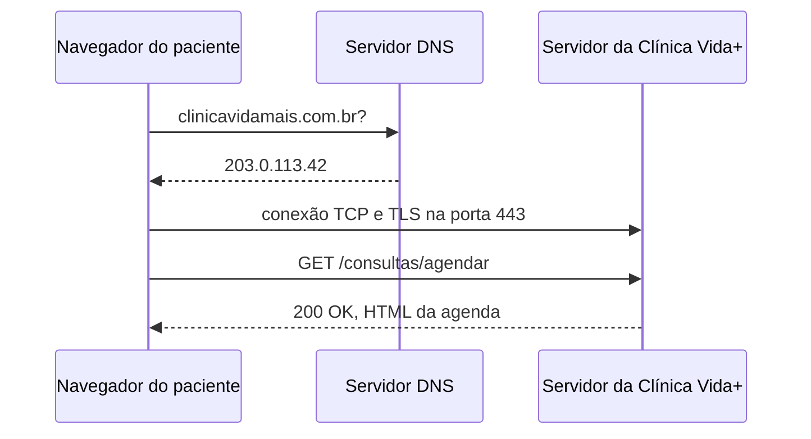

# Arquitetura da Clínica Vida+

## O caminho de uma requisição

## Evidência do DNS

> nslookup github.com
Servidor:  dns.google
Address:  8.8.8.8

Resposta não autoritativa:
Nome:    github.com
Addresses:  140.82.121.4
          140.82.121.3

## Evidência do HTTP

| Método | Recurso | Status | Descrição |
| :--- | :--- | :--- | :--- |
| `GET` | `/` | 200 OK | Carregamento da página inicial do site. |
| `GET` | `/index-D-S89MAN.css` | 200 OK | Arquivo de estilos (CSS) da interface. |
| `GET` | `/LabelPicker-Dg-Vp9nY.js` | 200 OK | Script de funcionalidade (JavaScript). |
| `GET` | `/pagina-que-nao-existe` | 404 Not Found | Teste de requisição para recurso inexistente. |

## Por que o formulário de agendamento precisa de HTTPS

## Por que o formulário de agendamento precisa de HTTPS

O formulário de agendamento da Clínica Vida+ precisa de HTTPS para proteger as informações dos pacientes. O HTTPS funciona criando um "tubo protegido" onde todos os dados enviados pelo site são codificados (criptografados). Assim, ninguém no meio do caminho consegue ler ou espiar as informações.

Essa proteção é muito importante porque o agendamento lida com dados pessoais sensíveis, como o CPF, telefone e a especialidade médica que a pessoa procura. Se o site usasse o HTTP comum, esses dados viajariam sem segurança e poderiam ser interceptados por hackers em redes Wi-Fi públicas.

Além de proteger o envio dos dados, o HTTPS garante ao paciente que ele está navegando no site real da clínica, e não em uma página falsa criada para aplicar golpes. É essa tecnologia que faz aparecer o ícone do cadeado ao lado do endereço do site.

Por fim, usar o HTTPS é obrigatório para que a clínica cumpra a LGPD (Lei Geral de Proteção de Dados). Proteger os dados de saúde dos pacientes é fundamental tanto para respeitar a privacidade das pessoas quanto para seguir as leis brasileiras.